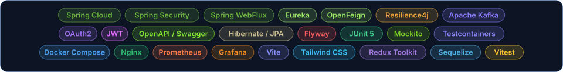

<p align="center">
  
</p>

<p align="center">
  
</p>

<p align="center">
  <a href="https://adrian0511.dev"></a>
  <a href="https://linkedin.com/in/adrdev"></a>
  <a href="https://github.com/adrian0511?tab=repositories"></a>
  <a href="README.md"></a>
</p>

---

## About me

**Backend** developer focused on Java and the Spring ecosystem, working mainly on **distributed
systems**: microservices, asynchronous messaging and contract-documented APIs. I also work on the
client side (React, TypeScript), because designing a good API means understanding whoever
consumes it, and I write Python APIs with FastAPI when the problem calls for something lighter.

Day to day that means **Spring Boot 4** and **Spring Cloud** over **Kafka**, with hexagonal
architecture and tests across every layer. The breakdown of how I approach each piece is below.

Santa Cruz de Bezana, Cantabria (Spain) · [adrian0511.dev](https://adrian0511.dev)

---

## Published on Maven Central

**[`prompt-link`](https://github.com/adrian0511/prompt-link)** — a reusable Java client for
generative AI through OpenRouter, with Spring Boot auto-configuration.

<a href="https://central.sonatype.com/artifact/io.github.adrian0511/prompt-link"></a>

```xml
<dependency>
    <groupId>io.github.adrian0511</groupId>
    <artifactId>prompt-link</artifactId>
    <version>1.1.0</version>
</dependency>
```

- Auto-configuration: just add the dependency, no `@EnableFeignClients` needed
- **Isolated** Feign client — the API key interceptor lives only in its own context, so the key
  never leaks into the application's other Feign clients
- **Typed** errors (`AiClientException`): tells API errors, network errors, unusable responses
  and configuration mistakes apart
- Token *streaming* with `Flux<String>` on WebFlux, plus multi-turn conversations

---

## Projects

| Project | What it is | Stack |
|---|---|---|
| **[orderflow](https://github.com/adrian0511/orderflow)** | Ordering platform across **9 microservices**: catalogue, inventory reservation, simulated payment and email notification, coordinated by events. | Java 21 · Spring Boot 4 · Kafka · OAuth2 |
| **[finance-tracker](https://github.com/adrian0511/finance-tracker)** | Personal finance manager with an AI assistant that categorises transactions. A single artifact: the backend serves the React client from the jar itself — no CORS, no double deployment. | Spring Boot · React · PostgreSQL · JWT |
| **[cookbook](https://github.com/adrian0511/cookbook)** | Full-stack recipe manager with **hexagonal architecture** (ports and adapters), domain invariants, pagination, ingredient search and ratings. **102 tests**. | Java 21 · Spring Boot 4 · React 19 · PostgreSQL |
| **[portfolio](https://github.com/adrian0511/portfolio)** · [live](https://adrian0511.dev) | Reactive portfolio that consumes the GitHub API in real time, with *timeouts*, *fallbacks* and Spanish/English i18n. | Spring WebFlux · React 18 · Vite |
| **[gym-reservas](https://github.com/adrian0511/gym-reservas)** | Gym class booking with real-time capacity, waiting list and role-based access control. | NestJS · React 18 · TypeScript · PostgreSQL |
| **[ride-hailing-microservices](https://github.com/adrian0511/ride-hailing-microservices)** | Ride-hailing microservices with centralised authentication: `authorization_code` for users and `client_credentials` between services. | Spring Cloud · OAuth2 · Eureka · OpenFeign |
| **[challengehub](https://github.com/adrian0511/challengehub)** | REST API for challenges and rewards: per-user progress, badges and role-based access control, with entity-to-DTO mapping via MapStruct. | Java 25 · Spring Boot 4 · JWT · PostgreSQL |
| **[bug-hunt](https://github.com/adrian0511/bug-hunt)** | Two challenges sharing one *token bucket* implemented **exactly once**: a `stdin → stdout` filter and a URL shortener with per-IP *rate limiting*. | Python 3.12 · FastAPI · SQLite |

> The rest of the repositories are at **[github.com/adrian0511?tab=repositories](https://github.com/adrian0511?tab=repositories)**

---

## Stack

<p align="center">
  
</p>

<p align="center">
  
</p>

---

## Architecture and approach

| Area | How I work it |
|---|---|
| **API design** | Contract first with OpenAPI, living documentation in Swagger UI, validation with Postman |
| **Microservices** | Spring Cloud Gateway as the single entry point, Eureka for discovery, OpenFeign between services |
| **Resilience** | Circuit breakers and *fallbacks* with Resilience4j, explicit *timeouts*, controlled degradation |
| **Event-driven** | Kafka to decouple services; saga for eventual consistency across orders and payments |
| **Security** | Spring Security + OAuth2 Authorization Server, JWT with *scopes* and roles |
| **Architecture** | Hexagonal and DDD: the domain knows nothing about Spring or the database |
| **Testing** | JUnit 5, Mockito, AssertJ and Spring *slices* on the backend; Vitest and Testing Library on the frontend |
| **Persistence** | PostgreSQL and MySQL with JPA/Hibernate; Sequelize on NestJS; SQLAlchemy on Python |
| **Infrastructure** | Docker Compose, Nginx as a *reverse proxy*, Prometheus metrics and Grafana dashboards |

---

## Contributions

<p align="center">
  <picture>
    <source media="(prefers-color-scheme: dark)" srcset="https://raw.githubusercontent.com/adrian0511/adrian0511/output/github-contribution-grid-snake-dark.svg" />
    
  </picture>
</p>

---

## What I am working on

- Maintaining **prompt-link** on Maven Central: *streaming*, typed errors and Spring Boot 4 compatibility.
- Taking the **saga** pattern in `orderflow` to a flow with full compensations over Kafka.
- Consolidating the **hexagonal architecture** of `cookbook` as a base template for new services.
- End-to-end observability: Spring Actuator metrics in Prometheus and dashboards in Grafana.

---

## Let's talk

I am open to **backend developer** roles (Java / Spring) and to collaborating on distributed
systems projects. If you got here from a job posting or a project of your own, LinkedIn is the
fastest way to reach me:

<p align="center">
  <a href="https://linkedin.com/in/adrdev"></a>
  <a href="https://adrian0511.dev"></a>
</p>

<p align="center">
  <i>Always learning · Always building · Always shipping</i>
</p>
